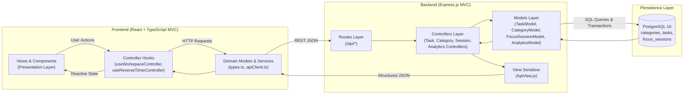

# ChronoFocus — Architecture & Design Principles

ChronoFocus is structured around the **Model-View-Controller (MVC)** architectural pattern across both its Express.js backend and React + TypeScript frontend, adhering to **SOLID** and **DRY** software engineering principles.

---

## 1. System Architecture Diagram

---

## 2. MVC Breakdown

### Backend (`backend/src/`)
- **ORM & Security Layer (`src/config/database.js` & `src/models/entities.js`)**:
  - Uses **Sequelize ORM** (`Category`, `Task`, `FocusSession` extending `Sequelize.Model`) to map PostgreSQL tables to JavaScript domain classes.
  - Prevents **SQL Injection** across the entire application by eliminating raw string-interpolated SQL and using Sequelize's query builder, typed `DataTypes` validations, `Op` operators (`Op.iLike`, `Op.between`, `Op.or`), and managed ACID transactions (`sequelize.transaction`).
- **Models (`src/models/`)**: Encapsulate all Sequelize ORM queries, relational associations, and transactions.
  - `CategoryModel.js`: Manages task types (Courses, Projects, Hobbies, etc.) and aggregates time spent per category via Sequelize eager loading (`include`).
  - `TaskModel.js`: Handles scheduled tasks, time budgets (`planned_duration_minutes`), accumulated time (`actual_duration_seconds`), priorities, statuses, and JSONB sub-checklists using Sequelize `Task` and `Op` operators.
  - `FocusSessionModel.js`: Executes atomic Sequelize transactions (`sequelize.transaction`) that record reverse chronometer sessions and increment the parent task's accumulated focus time.
  - `AnalyticsModel.js`: Computes the **Daily Resume** and **My Best Time** metrics (longest session, best productive day, peak productivity hour, and 7-day trend) through ORM queries.
- **Views (`src/views/`)**:
  - `ApiView.js`: Standardizes JSON response envelopes (`{ status, data, meta }`) and error payloads.
- **Controllers (`src/controllers/`)**:
  - Validate incoming HTTP requests, invoke the appropriate Model methods, and delegate serialization to `ApiView`.
- **Routes (`src/routes/`)**:
  - Map HTTP verbs and URI paths to controller handlers.

### Frontend (`frontend/src/`)
- **Models (`src/models/types.ts`)**: Strict TypeScript interfaces for `Category`, `Task`, `FocusSession`, `DailyResume`, and `PerformanceMetrics`.
- **Views (`src/views/` & `src/components/`)**: Purely declarative React components (`FocusDashboardView`, `SchedulePlannerView`, `CategoriesView`, `AnalyticsResumeView`, `ReverseChronometer`).
- **Controllers (`src/controllers/`)**:
  - `useReverseTimerController.ts`: Manages the reverse countdown state machine, drift-compensated wall-clock delta calculation, audio cues, and session logging.
  - `useWorkspaceController.ts`: Orchestrates state synchronization, filtering, and CRUD actions between the Views and `apiClient`.

---

## 3. SOLID & DRY Principles Applied

1. **Single Responsibility Principle (SRP)**:
   - Database connection pooling (`config/database.js`), SQL data models (`models/*.js`), request validation (`controllers/*.js`), error formatting (`middlewares/errorHandler.js`), and time formatting (`utils/timeFormatters.ts`) are isolated into single-purpose modules.
2. **Open/Closed Principle (OCP)**:
   - Task types (`categories`) are dynamically extensible with custom colors, icons, and daily targets without modifying core application logic.
3. **Liskov Substitution & Interface Segregation (LSP / ISP)**:
   - Frontend views consume focused controller interfaces and strongly typed payload contracts (`CreateTaskPayload`, `LogSessionPayload`).
4. **Dependency Inversion Principle (DIP)**:
   - Express app setup (`app.js`) is decoupled from network socket binding and DB initialization (`server.js`). Frontend views depend on controller hooks rather than direct `fetch` calls.
5. **Don't Repeat Yourself (DRY)**:
   - Shared `asyncHandler` eliminates repetitive `try/catch` blocks across controllers.
   - Shared `timeFormatters.ts` centralizes all countdown (`MM:SS` / `HH:MM:SS`) and human duration (`1h 25m`) conversions.

