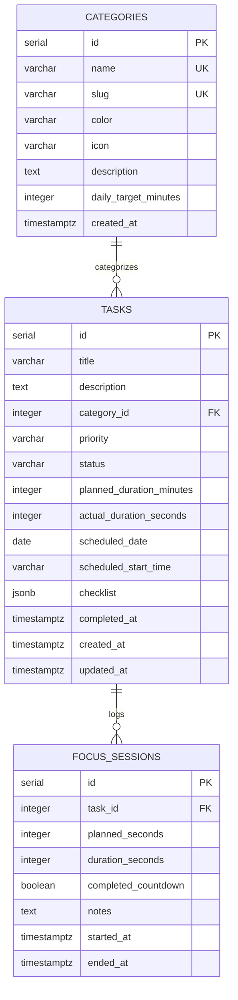

# ChronoFocus — PostgreSQL Database Schema

## Entity-Relationship Diagram

## Indexes & Constraints
- `idx_tasks_scheduled_date`: Accelerates daily schedule & daily resume queries.
- `idx_tasks_category_id`: Speeds up category breakdown aggregations.
- `idx_tasks_status`: Optimizes completion rate filtering.
- `idx_focus_sessions_task_id` & `idx_focus_sessions_started_at`: Optimizes best-time, peak productivity hour, and 7-day trend analytics.

